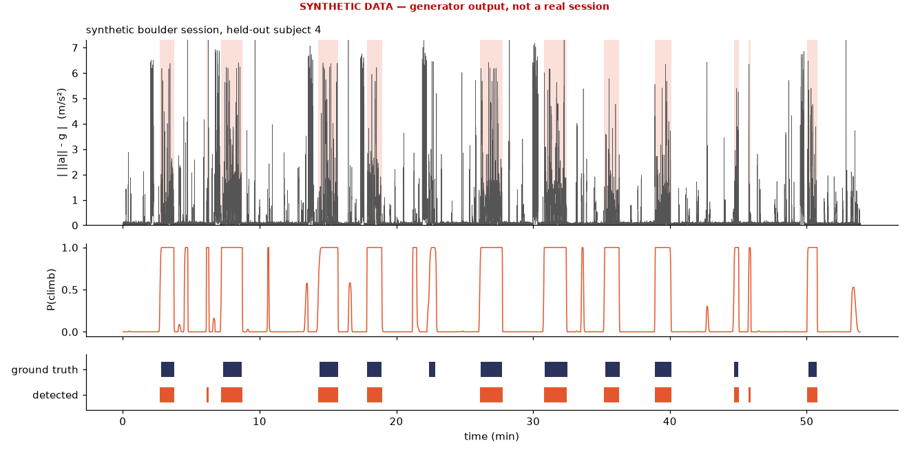

# climbtrack

**Climbing session tracking from a single wrist IMU.** Feed it the raw accelerometer stream of a
gym session (smartwatch CSV export, phone-logger CSV, or a `.fit` file that contains
`accelerometer_data`) and it will

* segment the session into **climbs vs. everything else** (rest, walking around, belaying),
* count climbs, estimate **time on wall**, ascent durations and rest intervals,
* compute per-climb **movement metrics**: pauses on the wall, move rate, jerk-based smoothness
  (LDLJ-A), spectral arc length (SPARC), and explosiveness proxies,
* write a Markdown/JSON **session report** with a timeline figure.

Classical signal processing + a small sticky HMM. No neural nets, no GPU, a few seconds of CPU per hour of 50 Hz data.

> [!WARNING]
> **Validation status: synthetic only.** I could not find a public, openly-licensed wrist-IMU
> climbing dataset with climb/rest ground truth (details in [Data](#data-what-exists-and-what-doesnt)).
> Every number in this README comes from a **physically-motivated synthetic generator**, and it only
> shows that the pipeline recovers what the generator put in. Accuracy on real climbers is
> **unknown** until real sessions are recorded and labelled. The protocol and tools for that are in
> [`docs/DATA_COLLECTION.md`](docs/DATA_COLLECTION.md).



*Synthetic boulder session, held-out subject. Top: orientation-free dynamic acceleration
$\lvert\lVert\mathbf a\rVert-g\rvert$ with detected climbs shaded. Middle: HMM posterior
$P(\text{climb}\mid\mathbf x_{1:T})$. Bottom: detected vs. generator ground truth. The large
rectangular blocks between climbs are walking bouts, which are correctly rejected.*

---

## Quickstart

```bash
python -m venv .venv && . .venv/bin/activate
pip install -e ".[dev]"          # numpy, scipy, matplotlib (+ fitdecode, pytest)

# try it on a synthetic session (clearly stamped SYNTHETIC in the report)
climbtrack synth -o s.csv --labels s_labels.csv --seed 7
climbtrack analyze s.csv --labels s_labels.csv -o out --synthetic

# your own data
climbtrack analyze my_session.csv -o out            # CSV: t, ax, ay, az [, gx, gy, gz]
climbtrack analyze my_session.fit -o out            # FIT with accelerometer_data messages
```

CSV input: a time column (`t`/`time`/`timestamp`/`seconds_elapsed`, in s, ms or ns; auto-detected),
three accelerometer columns (`ax,ay,az`, `acc_x…`, SensorLog/Sensor Logger style names; g or m/s²,
auto-detected), optional gyroscope (`gx,gy,gz`, rad/s or deg/s). Jittery timestamps are linearly
resampled onto a uniform grid.

---

## Pipeline


## The math

### 1. Signal model and orientation-free acceleration

A wrist accelerometer measures specific force in the sensor frame,

$$
\mathbf a(t) = R(t)^\top\big(\ddot{\mathbf p}(t) + g\,\mathbf e_z\big) + \mathbf b + \boldsymbol\varepsilon(t),
$$

with $R(t)\in SO(3)$ the sensor-to-world rotation, $\ddot{\mathbf p}$ the wrist's linear
acceleration, $\mathbf b$ a bias and $\boldsymbol\varepsilon$ noise. The norm is invariant to
$R$, so the simplest feature that ignores how the watch sits on the wrist is the
**dynamic magnitude**

$$
d(t) = \big\lvert\,\lVert\mathbf a(t)\rVert - g\,\big\rvert .
$$

It is zero at rest in any posture, but it cannot see slow re-orientations of the arm, and those are
most of what climbing looks like at the wrist. So we also estimate gravity.

### 2. Gravity direction: low-pass or complementary filter

**Accelerometer only.** Gravity is the low-frequency part of $\mathbf a$:

$$
\hat{\mathbf g}(t) = \frac{(h_{\text{LP}} * \mathbf a)(t)}{\lVert (h_{\text{LP}} * \mathbf a)(t)\rVert},
\qquad h_{\text{LP}}: \text{2nd-order Butterworth, } f_c = 0.3\ \text{Hz, zero-phase}.
$$

**With a gyroscope** we run a first-order complementary filter on the unit gravity vector
(the attitude-only special case of Mahony et al., 2008). In the body frame a world-fixed vector
evolves as $\dot{\mathbf g} = \mathbf g\times\boldsymbol\omega$, so

$$
\tilde{\mathbf g}_k = \hat{\mathbf g}_{k-1} + \hat{\mathbf g}_{k-1}\times\boldsymbol\omega_k\,\Delta t,
\qquad
\hat{\mathbf g}_k = \frac{\alpha\,\tilde{\mathbf g}_k + (1-\alpha)\,\mathbf a_k/\lVert\mathbf a_k\rVert}
{\lVert\cdot\rVert},
\qquad \alpha = \frac{\tau}{\tau+\Delta t},\ \tau = 1\ \text{s}.
$$

The gyroscope handles fast rotations and the accelerometer removes slow drift. Linear acceleration
is then $\mathbf a_{\text{lin}} = \mathbf a - g\,\hat{\mathbf g}$.

> Segmentation features always use the accelerometer-only $\hat{\mathbf g}$. They then behave the same
> on every device, most watch exports have no gyro anyway, and the 0.3 Hz low-pass ignores
> sub-second fidgets. The complementary filter is used for the movement metrics when a gyro is present.

### 3. Window features (4 s windows, 1 s hop)

| feature | definition | why |
|---|---|---|
| arm-up fraction | $\frac1N\sum \mathbb 1[\phi(t) > 30^\circ]$, with $\phi = s\cdot\arcsin(\hat g_x)$ the forearm elevation | hands are above the shoulder on the wall far more than off it |
| tilt rate | $\log\big(\overline{\arccos(\hat{\mathbf g}_t\cdot\hat{\mathbf g}_{t-L})/L} + 0.05\big)$ | climbing = continual re-orientation of the forearm; mounting-invariant |
| dynamic RMS | $\log\big(\sqrt{\overline{d^2}} + 0.05\big)$ | reaches and hand placements |
| gait periodicity | $\max_{\ell\in[f_s/2.9,\ f_s/1.3]} \rho_{\lVert\mathbf a\rVert}(\ell)$ (normalised autocorrelation) | walking is rhythmic at 1.3–2.9 steps/s; climbing is not |

$s=\pm1$ is the forearm-axis sign (which wrist, crown orientation). It is inferred automatically
from walking bouts, where the arm hangs down, or set with `--forearm-sign`.

A climb is a minutes-long *regime*. Holds, chalk dips and shake-outs inside it look like rest at the
4 s scale, so the HMM sees the **15 s running median** of arm-up fraction, tilt rate and dynamic
RMS. A median rather than a mean, so that a single 4 s gesture at rest cannot light up a 15 s
neighbourhood.

### 4. Segmentation: sticky, tempered 2-state Gaussian HMM

States $z_t\in\{\text{rest},\text{climb}\}$, standardised context features $\mathbf x_t\in\mathbb R^3$,
diagonal Gaussian emissions. The transition matrix is **fixed** from expected durations, an explicit
stickiness prior rather than something learned:

$$
A_{kk} = 1-\frac{\Delta}{\bar D_k},\qquad \bar D_{\text{rest}} = 150\ \text{s},\ \ \bar D_{\text{climb}} = 60\ \text{s},\ \ \Delta = 1\ \text{s (hop)}.
$$

Overlapping windows are not conditionally independent, so the emission log-likelihood is
**tempered** to avoid an over-confident, flickering posterior:

$$
\log \tilde p(\mathbf x_t\mid z_t=k) = \beta\,\log\mathcal N(\mathbf x_t;\boldsymbol\mu_k,\operatorname{diag}\boldsymbol\sigma_k^2),\qquad \beta = \tfrac{\text{hop}}{\text{window}} = 0.25 .
$$

Emissions are learned **per session** by EM (Baum–Welch with scaled forward–backward, Rabiner 1989).
EM is initialised from an unsupervised score: a sigmoid of robust z-scores
$z(\cdot) = (\cdot - \operatorname{med})/(1.4826\,\mathrm{MAD})$,

$$
s_t = \sigma\Big(0.5\,z(\text{up}) + z(\text{tilt}) + z(\text{dyn}) - z(\text{periodicity}) - q_{0.7}\Big).
$$

So the model adapts to each person and device without labels. Windows with gait periodicity
$>0.5$ are **gated** to rest: they are excluded from the M-step, and the climb emission is set to
$-\infty$ for them during decoding. The climb state is the one with the larger
$\mu_{\text{up}}+\mu_{\text{tilt}}+\mu_{\text{dyn}}$. Viterbi gives the state path.

Post-processing: merge climbs separated by $<10$ s, drop climbs $<10$ s, and drop candidates whose
mean arm-up fraction is $<0.2$ or whose mean log dynamic RMS is $<-0.6$ (a plausibility gate whose
thresholds were picked on the synthetic *dev* subjects only).

Alternatives considered: change-point detection (e.g. PELT, Killick et al. 2012) on the same
features would work too. The HMM was chosen because it gives a posterior, which is useful for
human-in-the-loop correction, and because the duration prior is explicit.

### 5. Movement metrics (per climb)

Inside each climb, with $\mathbf a_{\text{lin}}$ from §2:

* **Activity** $m(t)=\text{LP}_{3\,\text{Hz}}\lVert\mathbf a_{\text{lin}}\rVert$ and **rotation**
  $r(t)=\lVert\boldsymbol\omega\rVert$ (gyro) or the gravity tilt rate (no gyro).
* **Pause**: a run of at least 2 s with $m<0.6\ \text{m/s}^2$ and $r<0.35\ \text{rad/s}$. Reported:
  count, total, fraction of climb, longest. Long pauses mid-route are where you are pumped, reading
  the route or scared.
* **Move**: an active run of at least 0.3 s between stills. Reported: count and moves/min.
* **Smoothness, LDLJ-A** (Melendez-Calderon et al. 2021, the IMU-appropriate variant of the log
  dimensionless jerk of Hogan & Sternad 2009 / Balasubramanian et al. 2015), per move, median over the
  climb:

$$
\mathrm{LDLJ\text{-}A} = -\ln\!\left(\frac{T}{a_{\text{peak}}^{2}}\int_{0}^{T}\left\lVert\frac{d\mathbf a_{\text{lin}}}{dt}\right\rVert^{2}dt\right),
\qquad
\mathrm{LDLJ\text{-}V} = -\ln\!\left(\frac{T^{3}}{v_{\text{peak}}^{2}}\int_{0}^{T}\lVert\dddot{\mathbf p}\rVert^{2}dt\right).
$$

  For a minimum-jerk reach, $\int\dddot p^{\,2}dt = 720D^2/T^5$ and $v_{\text{peak}}=1.875D/T$, so
  LDLJ-V $=-\ln(720/1.875^2)\approx-5.32$, independent of $D$ and $T$. This is a unit test.
* **Smoothness, SPARC** (Balasubramanian et al. 2012, 2015) on $r(t)$ per move. With
  $\hat V(\omega)=\lvert V(\omega)\rvert/\lvert V(0)\rvert$ the normalised magnitude spectrum,

$$
\mathrm{SPARC} = -\int_{0}^{\omega_c}\sqrt{\Big(\frac{1}{\omega_c}\Big)^{2}+\Big(\frac{d\hat V}{d\omega}\Big)^{2}}\,d\omega,
\qquad \omega_c=\min\{\omega_c^{\max},\ \min\{\omega:\hat V(r)<\bar V\ \forall r>\omega\}\},
$$

  with $\omega_c^{\max}=2\pi\cdot10$ Hz and $\bar V=0.05$. Less negative means smoother. A
  single minimum-jerk profile gives about $-1.40$, which is also a unit test.
* **Explosiveness proxies**: peak $\lVert\mathbf a_{\text{lin}}\rVert$, 95th percentile of jerk
  magnitude, and "bursts" (peaks $>15\ \text{m/s}^2\approx1.5g$, at least 0.5 s apart) as a crude
  dyno/deadpoint counter.

Jerk has a history in climbing research as a fluency indicator. Seifert et al. (2014) used hip jerk
to separate skill levels. A **wrist** is not a hip, so treat these numbers as within-person,
same-device trend indicators, not as cross-person scores.

## Results (synthetic only)

`python scripts/bench_synthetic.py` uses a subject-wise split. Synthetic subjects 0–3 were used while
designing features and thresholds; subjects 4–15 are held out. Each subject has one boulder and one
rope session (6–12 and 3–6 climbs, 30–60 min). An event counts as matched at **IoU ≥ 0.5**, one-to-one.

| split | method | fs | sessions | climbs | P | R | event F1 | mean IoU | count MAE | frame F1 | time-on-wall rel. err |
|---|---|---|---|---|---|---|---|---|---|---|---|
| test | **HMM** | 50 | 24 | 177 | 0.94 | 0.95 | **0.94** | 0.90 | 0.58 | 0.94 | 5.0 % |
| test | HMM | 25 | 24 | 177 | 0.95 | 0.92 | 0.93 | 0.88 | 0.79 | 0.92 | 7.8 % |
| test | hysteresis threshold (baseline) | 50 | 24 | 177 | 0.49 | 0.76 | 0.59 | 0.84 | 4.46 | 0.86 | 17.8 % |

Full table in [`docs/bench_synthetic.md`](docs/bench_synthetic.md). **These numbers are not evidence
that the method works on real climbers.** They show that the HMM with temporal context beats
per-window thresholding under the generator's assumptions, and that the code is wired correctly.
The typical error is a detected climb that starts a few seconds early, because the generator puts
fidgeting while reading the problem right before each climb. That probably happens in real life
too.

## Data: what exists and what doesn't

Searched October 2026 (Zenodo, Figshare, UCI, PhysioNet, GitHub, papers' data statements):

| source | what it is | usable as verifier here? |
|---|---|---|
| Kosmalla et al. 2015, *ClimbSense* (wrist IMUs, route recognition) | paper | no public data found |
| Ladha et al. 2013, *ClimbAX* (limb accelerometers, skill assessment) | paper | no public data found |
| Pansiot et al. 2008, *ClimBSN* (ear-worn sensor) | paper | no public data found |
| Boulanger et al. 2016 (IMUs, climbing activity classification) | paper | no public data found |
| CIMI4D (CVPR 2023), AscendMotion/ClimbingCap (CVPR 2025) | full-body IMU mocap + LiDAR + RGB of climbing | pose-centric, climbing-only sequences (no rest/walking/belay context, no wrist-watch setup), access by request under research terms. Not a session-segmentation verifier |
| PhysioNet "walking, stair climbing and driving" | wrist/hip accelerometry | stair climbing, not rock climbing |

**Board-climbing grade prediction** (MoonBoard etc.) was considered and **skipped**: I found no clear
open data licence for the problem databases.

So the real-data benchmark is an explicit **TODO**:
[`docs/DATA_COLLECTION.md`](docs/DATA_COLLECTION.md) gives a recording protocol (devices, sync, what
to label), the `climbtrack label` stopwatch labeller, `climbtrack align` (3-tap sync) and the exact
evaluation to run (leave-one-subject-out once there are at least 5 people).

## Synthetic generator: assumptions

`climbtrack.synth` produces a 6-axis IMU from a kinematic model. Orientation follows ZYX Euler angles
with minimum-jerk transitions. The accelerometer is $R^\top(\ddot{\mathbf p}+g\mathbf e_z)$ plus
bias and noise. The gyro is derived from Euler-angle rates. The activities are:

* **rest**: arm hanging or on the lap, slow drift, and gestures every 12–40 s (drink, phone, chalk,
  talking with hands);
* **walking**: arm swing at stride frequency, vertical bounce and heel strike at 1.6–2.1 steps/s;
* **belaying** (rope sessions, labelled *rest*): arm at chest height, rope-pull cycles of about
  0.6 Hz. This is a deliberate confounder;
* **climbing**: alternating moves (0.4–1.2 s minimum-jerk re-orientation to a forearm elevation
  of −25…88°, plus a 0.2–0.8 m minimum-jerk hand displacement, mostly upward) and holds (0.4–5 s
  with 8–12 Hz isometric tremor). It also includes shake-outs with 3–5 Hz shaking.

Per-subject parameters (tempo, reach, wall posture, tremor, fidget rate, noise) are randomised.
**Known unrealism:** no falls, no down-climbing, no traversing, no true load-dependent
signals, no strap slip, and gestures at rest are i.i.d. Real sessions will be messier.

## Limitations

* **No real-data validation yet.** This is the single biggest limitation. The thresholds (30° arm-up,
  plausibility gate, 10 s merge/min) are informed guesses checked only on synthetic data.
* Wrist only. Footwork, hip trajectory and body tension are invisible. "Smoothness" is
  hand smoothness.
* Gestures with the arms up while off the wall (stretching, brushing holds with a brush on a stick,
  route-setting) can be mistaken for climbing. Belaying is handled in the generator but has not
  been tested on real data.
* Back-to-back attempts with less than 10 s between them are merged into one climb (configurable
  with `--merge-gap`).
* Accelerometer-only linear acceleration leaks orientation changes faster than 0.3 Hz into
  $\mathbf a_{\text{lin}}$. With a gyro this is much reduced.
* FIT parsing is implemented with `fitdecode` but **untested on a real device file**. Most watches do
  not store raw `accelerometer_data` unless a developer or raw-logging app is used.
* Video pose analysis (centre-of-mass path, hip-to-wall distance) is **not implemented**. It would
  need a pose model (e.g. MediaPipe), which goes against this repo's "light" constraint. It is
  left as future work.

<!-- TODO(Tommaso): dictate 3-4 lines in your own words -->

## Development

```bash
pip install -e ".[dev]" && pytest -q        # ~10 s
python scripts/bench_synthetic.py            # ~1 min, rewrites docs/bench_synthetic.md + figure
```

## References

* Balasubramanian, S., Melendez-Calderon, A., Burdet, E. (2012). A robust and sensitive metric for quantifying movement smoothness. *IEEE Trans. Biomed. Eng.* 59(8). https://doi.org/10.1109/TBME.2011.2179545
* Balasubramanian, S., Melendez-Calderon, A., Roby-Brami, A., Burdet, E. (2015). On the analysis of movement smoothness. *J. NeuroEng. Rehabil.* 12:112. https://doi.org/10.1186/s12984-015-0090-9
* Boulanger, J., Seifert, L., Hérault, R., Coeurjolly, J.-F. (2016). Automatic sensor-based detection and classification of climbing activities. *IEEE Sensors J.* 16(3), 742–749. https://doi.org/10.1109/JSEN.2015.2481511
* Hogan, N., Sternad, D. (2009). Sensitivity of smoothness measures to movement duration, amplitude, and arrests. *J. Motor Behavior* 41(6). https://doi.org/10.3200/35-09-004-RC
* Killick, R., Fearnhead, P., Eckley, I. A. (2012). Optimal detection of changepoints with a linear computational cost. *JASA* 107(500). https://doi.org/10.1080/01621459.2012.737745
* Kosmalla, F., Daiber, F., Krüger, A. (2015). ClimbSense: Automatic climbing route recognition using wrist-worn inertia measurement units. *CHI '15*. https://doi.org/10.1145/2702123.2702311
* Ladha, C., Hammerla, N. Y., Olivier, P., Plötz, T. (2013). ClimbAX: Skill assessment for climbing enthusiasts. *UbiComp '13*. https://doi.org/10.1145/2493432.2493492
* Mahony, R., Hamel, T., Pflimlin, J.-M. (2008). Nonlinear complementary filters on the special orthogonal group. *IEEE Trans. Automatic Control* 53(5). https://doi.org/10.1109/TAC.2008.923738
* Melendez-Calderon, A., Shirota, C., Balasubramanian, S. (2021). Estimating movement smoothness from inertial measurement units. *Front. Bioeng. Biotechnol.* 8:558771. https://doi.org/10.3389/fbioe.2020.558771
* Pansiot, J., King, R. C., McIlwraith, D. G., Lo, B. P. L., Yang, G.-Z. (2008). ClimBSN: Climber performance monitoring with BSN. *ISSS-MDBS 2008*. https://doi.org/10.1109/ISSMDBS.2008.4575009
* Rabiner, L. R. (1989). A tutorial on hidden Markov models and selected applications in speech recognition. *Proc. IEEE* 77(2). https://doi.org/10.1109/5.18626
* Seifert, L., Orth, D., Boulanger, J., Dovgalecs, V., Hérault, R., Davids, K. (2014). Climbing skill and complexity of climbing wall design: assessment of jerk as a novel indicator of performance fluency. *J. Appl. Biomech.* 30(5). https://doi.org/10.1123/jab.2014-0052

All DOIs were resolved against Crossref on 2026-10-30.

## License & citation

MIT, see [LICENSE](LICENSE). If you use this, please cite it via [CITATION.cff](CITATION.cff).
